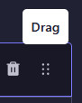
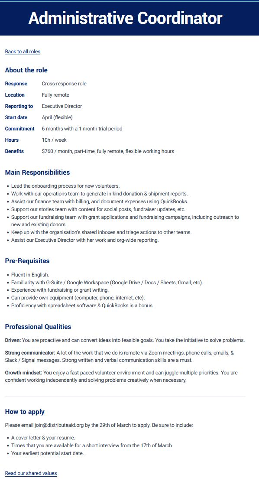
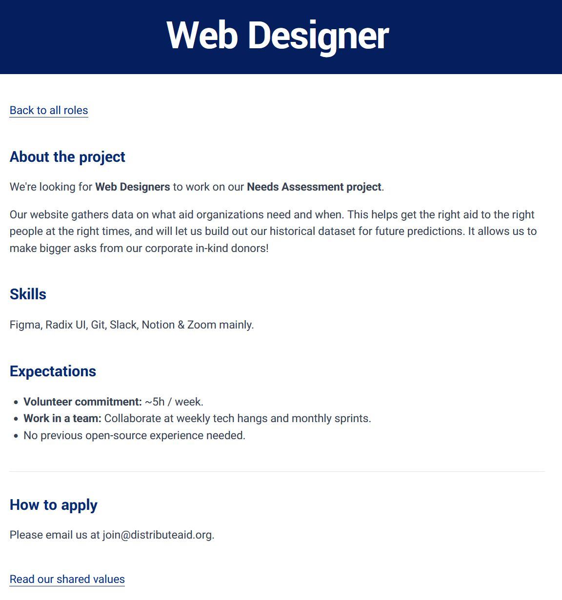

## Purpose

Use the Recruiting.Role collection to create and update role listings for Distribute Aid's Work with us page. Each entry represents one role that people can apply for.

Use Role details for short facts, Sections for longer explanations, and Application instructions for how to apply. The same fields work for paid, stipend-supported, and volunteer roles; include only information that applies to the role.

## How this content reaches the website

Open, published roles appear on **Work with us**, at `/work-with-us`. Selecting a title opens that role's individual page at `/work-with-us/[slug]`.

The individual page displays:

1. The role title.
2. Short label-and-value facts under **About the role**, when provided.
3. Your sections, in their arranged order.
4. Application instructions under **How to apply**.

The website supplies the **About the role** and **How to apply** headings and the shared-values link. Do not repeat them inside the text fields.

Both the list and individual pages require the published role's isOpen setting to be **TRUE**. Saving is not publishing. Switching isOpen to **FALSE** in an unpublished revision does not, by itself, update the public listing.

## Before you begin

- Sign in to the Strapi environment approved for your task. Use staging or a local environment for practice, never production.
- Get the approved role title, description, application instructions, and open/closed decision from the content owner.
- Check that application links, dates, hours, and any compensation information are current.

You can start with the information available and save unfinished work. Complete the publication checks only when the entry is ready to publish.

## Open the collection

1. Sign in to the approved Strapi environment.
2. Open **Content Manager**.
3. Select **Recruiting.Role**.
4. To add a role, select **Create new entry**.
5. To edit a role, find its title in the entry list and open it. Check its title and slug before changing it, especially when similarly named roles exist.

## Save your progress

1. Enter the information you have.
2. Select **Save**.
3. Check for **Saved document** and the entry status before leaving.
4. To continue later, reopen the same entry from the collection list.

A new saved entry shows **Draft** and is not a public role listing. You can save it before all required fields are complete and return later.

Saving changes to an already-published role shows **Modified**. The previous published version remains on the website until you publish the revision. Do not use a successful save as proof that all required information is complete.

## Top-level fields

“Required?” means required by the collection configuration for publication, not an editorial recommendation. Role details and Sections are optional lists, but each item you add has required subfields. An isOpen value of **FALSE** is valid: required does not mean it must be switched on. The editor displays **TRUE** and **FALSE**, not Yes and No.

| Field name                   | Field type                    | What to enter                                                                                                                                                | Example                                                                 | Required?                            | Where it appears                                           |
| ---------------------------- | ----------------------------- | ------------------------------------------------------------------------------------------------------------------------------------------------------------ | ----------------------------------------------------------------------- | ------------------------------------ | ---------------------------------------------------------- |
| title                        | Short text                    | Enter the approved public role title, up to 250 characters.                                                                                                  | Volunteer Logistics Coordinator                                         | Yes                                  | Work with us list link and individual page title           |
| slug                         | URL identifier based on title | Click **Regenerate** to generate a lowercase, hyphen-separated slug from the title, or enter one manually.                                                   | `volunteer-logistics-coordinator`                                       | Yes                                  | Role page address after `/work-with-us/`                   |
| isOpen                       | Yes/no                        | Choose **TRUE** for an approved open role, **FALSE** for a closed one. New entries default to FALSE. Publish the intended setting when ready.                | TRUE for an approved open role                                          | Yes; either TRUE or FALSE            | Controls availability in both the list and individual page |
| [roleDetails](#role-details) | Repeatable component          | Add one short label-and-value fact per item. Do not add empty facts for information that does not apply.                                                     | Location → Remote                                                       | No; both subfields required per item | About the role                                             |
| [sections](#sections)        | Repeatable component          | Add one heading and body per topic. Arrange items in reading order.                                                                                          | Responsibilities → description of the work                              | No; both subfields required per item | Individual page, after role details                        |
| applicationInstructions      | Rich text                     | Explain how to apply, what to send, any deadline, and the approved destination. Include a working link where needed. Do not repeat the How to apply heading. | Use the approved application form and submit the requested information. | Yes                                  | How to apply                                               |

There is no role image field in this collection. You do not need to upload an image or follow another collection's Cloudinary procedure.

## Component fields

A repeatable component is a list of items within the role. Add an item for each fact or topic you want to show; complete both fields in every item you keep.

### Role details

Use this list for short facts that readers should be able to scan, such as location, time commitment, compensation, or reporting line. Include these only when applicable and approved.

1. Find roleDetails. For the first item, select **No entry yet. Click to add one.**
2. Complete label and value.
3. Select **Add an entry** for each additional fact.
4. Add facts in the intended reading order. To move an existing item, follow [Reorder role details or sections](#reorder-role-details-or-sections).

| Subfield | Field type | What to enter                           | Example  | Required?                   | Where it appears                |
| -------- | ---------- | --------------------------------------- | -------- | --------------------------- | ------------------------------- |
| label    | Short text | A short name for the fact.              | Location | Yes, when the item is added | Bold label under About the role |
| value    | Short text | The approved information for that fact. | Remote   | Yes, when the item is added | Beside the label                |

[Back to the top-level fields table](#top-level-fields)

### Sections

Use this list for topics needing a heading and fuller explanation, such as Responsibilities, Skills, or What we offer. There is no requirement to use all these headings or a fixed number of sections.

1. Find sections. For the first item, select **No entry yet. Click to add one.**
2. Complete heading and content for that topic.
3. Select **Add an entry** for each additional topic.
4. Add topics in the intended reading order. To move an existing item, follow [Reorder role details or sections](#reorder-role-details-or-sections).

| Subfield | Field type | What to enter                                                                                                        | Example                                                | Required?                   | Where it appears                       |
| -------- | ---------- | -------------------------------------------------------------------------------------------------------------------- | ------------------------------------------------------ | --------------------------- | -------------------------------------- |
| heading  | Short text | A concise topic heading.                                                                                             | Responsibilities                                       | Yes, when the item is added | Section heading on the individual page |
| content  | Rich text  | The approved explanation. Use paragraphs, bullets, bold emphasis, and links where useful; check the rendered result. | Coordinate supply requests and keep the team informed. | Yes, when the item is added | Below that heading                     |

[Back to the top-level fields table](#top-level-fields)

### Reorder role details or sections

Use the dotted **Drag** handle on the far right of an item to change its position in roleDetails or sections.



1. Find the item you want to move.
2. Point to its dotted handle until the **Drag** tooltip appears.
3. Press and hold the mouse button on the handle, move the item up or down to its intended position, then release.
4. Check the item order and select **Save**.
5. When the changes are approved and ready, select **Publish**, then check the order on the individual role page. Saving alone does not update an already-published role.

## Formatting text in Strapi

Use rich text in the content field within sections and in applicationInstructions. Keep title, labels, values, and section headings as short plain text.

For this guide, type or paste Markdown directly into the content field rather than applying formatting with the toolbar. Markdown is plain text with a few punctuation marks for bullets, emphasis, and links. The examples below show exactly what to enter.

If you use the formatting buttons, limit them to bold, italic, bullet lists, numbered lists, and links. Avoid the **Headings** dropdown, **Underline**, and **Strike-through**. The examples in this guide use Markdown.

The entry-level website preview is not configured in the tested setup. The rich-text editor's **Preview mode** is separate and does not guarantee the same result on the website. Check the role page after publishing.

### A small Markdown reference

Use this reference when typing or pasting into sections → content or applicationInstructions. The punctuation is part of what you enter; the website turns it into formatting. It is not a separate role-layout setting.

| What you want   | Markdown source                                 |
| --------------- | ----------------------------------------------- |
| Bold emphasis   | `**Important information**`                     |
| Italic emphasis | `*Additional context*`                          |
| A bullet        | `- One responsibility`                          |
| A numbered step | `1. Complete the application form.`             |
| A link          | `[Application form](https://example.org/apply)` |
| A new paragraph | Leave a blank line between paragraphs.          |

The link above is an illustration, not an application destination. Replace it with the approved role-specific link.

For example, a section's content could use:

```md
Coordinate supplies with the team.

- Keep requests up to date.
- Share **important changes** with the coordinator.
```

Enter the section title in heading, not as a duplicate heading at the start of content. Likewise, do not repeat How to apply inside applicationInstructions.

## Worked examples: two ways to organize a role

These examples use the same website layout, not two selectable templates. Choose fields according to the information you need to communicate:

- Use roleDetails for short label-and-value facts.
- Use sections for longer topics with their own headings.
- Use applicationInstructions for how to apply.

### Example 1: a role with an About the role facts list

The Administrative Coordinator example starts with **About the role**, followed by longer topics.

1. Create a new Recruiting.Role entry and enter its approved title in title.
2. Check or enter the intended slug.
3. In roleDetails, add one item per short fact. Enter its name in label and its information in value. For example, use Location as the label and the approved working location as the value.
4. Add other applicable facts, such as reporting line, start date, commitment, hours, or benefits. Do not add empty items merely to match the screenshot.
5. In sections, create three separate items using the [exact section examples below](#recreate-the-three-administrative-coordinator-sections). Each item has its own heading and content; do not paste all three topics into one item.
6. Enter the approved application steps in applicationInstructions. Do not type the How to apply heading.
7. Save your progress. When the entry is complete, follow the [publishing checklist](#before-publishing) and the publishing procedure below.
8. On the website, compare the field locations with the example: title, short facts, longer sections, then application instructions.



| Website area                                                      | What to complete in Strapi                   |
| ----------------------------------------------------------------- | -------------------------------------------- |
| Administrative Coordinator title                                  | title                                        |
| Short facts under About the role                                  | roleDetails: label and value for each item   |
| Main Responsibilities, Pre-Requisites, and Professional Qualities | sections: heading and content for each topic |
| Text below How to apply                                           | applicationInstructions                      |

#### Recreate the three Administrative Coordinator sections

The following text reproduces the three topics in the example screenshot. Use it for practice in a local or staging environment. It is example content, not approval to publish a current vacancy.

For each topic:

1. Find sections. Select **No entry yet. Click to add one.** for the first item, or **Add an entry** for the next item.
2. In heading, enter only the heading given below. Do not add `#`, a bullet, or bold markers; the website styles the heading for you.
3. In content, enter the corresponding body text using the instructions below.
4. Repeat until you have three items, in this order: Main Responsibilities, Pre-Requisites, Professional Qualities.

**Enter the body text using Markdown:**

Copy the text inside the matching code block into content, or type it exactly as shown. Include the bullet prefixes (a hyphen followed by a space), the `**` bold markers, and the blank lines. Do not copy the surrounding triple backticks or the word `md`, and do not use the formatting buttons for these examples.

The Markdown marks may be visible while you are editing. That is expected in the source text; the important check is how the content appears on the website.

Markdown uses a hyphen followed by a space (`-` then a space) at the start of each line for a bullet. It uses a pair of asterisks on each side of text, such as `**Driven:**`, to mark that text as bold. Blank lines separate paragraphs.

##### First item: Main Responsibilities

Enter this in heading:

```text
Main Responsibilities
```

For content, copy the following block or type each line with a hyphen followed by a space (`-` then a space). Press Enter once between responsibilities. Long lines wrap automatically; do not press Enter just because a line reaches the edge of the editor. Each line beginning with a hyphen and a space becomes one bullet on the website.

Copyable Markdown source:

```md
- Lead the onboarding process for new volunteers.
- Work with our operations team to generate in-kind donation & shipment reports.
- Assist our finance team with billing, and document expenses using QuickBooks.
- Support our stories team with content for social posts, fundraiser updates, etc.
- Support our fundraising team with grant applications and fundraising campaigns, including outreach to new and existing donors.
- Keep up with the organisation’s shared inboxes and triage actions to other teams.
- Assist our Executive Director with her work and org-wide reporting.
```

**Check the result:** you should see seven bullets, one for each line above, with no extra empty bullet. The heading belongs above the list, not inside it.

##### Second item: Pre-Requisites

Select **Add an entry** and enter this in the new item's heading:

```text
Pre-Requisites
```

For content, copy the following block or type each line with its leading hyphen and space included. Press Enter once between prerequisites so each becomes a separate bullet.

Copyable Markdown source:

```md
- Fluent in English.
- Familiarity with G-Suite / Google Workspace (Google Drive / Docs / Sheets, Gmail, etc).
- Experience in fundraising or grant writing.
- Can provide own equipment (computer, phone, internet, etc).
- Proficiency with spreadsheet software & QuickBooks is a bonus.
```

**Check the result:** five bullets should appear beneath Pre-Requisites. Do not bold the entire list or repeat the heading in content.

##### Third item: Professional Qualities

Select **Add an entry** and enter this in the new item's heading:

```text
Professional Qualities
```

This body uses three paragraphs, not a bulleted list. Only the short introductory label of each paragraph is bold.

Copy the following block into content, or type it as shown:

1. Include `**Driven:**`, `**Strong communicator:**`, and `**Growth mindset:**` exactly, with two asterisks before each label and two after its colon.
2. Leave the explanation outside those markers so only the label becomes bold.
3. Leave a blank line between paragraphs: when typing, press Enter twice after each paragraph.
4. Do not add a hyphen and space before these paragraphs; this section is not a bullet list.

Copyable Markdown source:

```md
**Driven:** You are proactive and can convert ideas into feasible goals. You take the initiative to solve problems.

**Strong communicator:** A lot of the work that we do is remote via Zoom meetings, phone calls, emails, & Slack / Signal messages. Strong written and verbal communication skills are a must.

**Growth mindset:** You thrive in a fast-paced volunteer environment and can juggle multiple priorities at once. You are comfortable working independently and solving problems creatively when necessary.
```

**Check the result:** three separate paragraphs, no bullets, and exactly three bold labels. The explanations should not be bold, and the page should not display literal asterisks.

##### Check all three sections together

1. Review the Markdown in each item's content: keep each bullet's leading hyphen and space, paired `**` bold markers, and blank lines shown above. Strapi's Preview mode can help you read it, but does not guarantee the same website result.
2. Save your progress and confirm all three items remain separate.
3. Once approved for publication in your test environment, follow the publishing procedure and inspect the individual role page.
4. Compare it with the screenshot: seven responsibilities, five prerequisites, and three professional-quality paragraphs, in that order. The website supplies the section heading styles; your content supplies the bullets and bold labels.

[Back to the top-level fields table](#top-level-fields)

### Example 2: a role organized around longer topics

The Web Designer example starts with **About the project** and has no short-facts summary. There is no separate layout setting to select.

1. Create a new Recruiting.Role entry and enter its approved title in title.
2. Check or enter the intended slug.
3. Leave roleDetails empty when the role does not need short summary facts. Do not add empty items.
4. In sections, add one item per topic, in the intended reading order:
   - heading: About the project; content: the approved project introduction.
   - heading: Skills; content: the approved skills information.
   - heading: Expectations; content: the approved expectations.
5. Enter the approved application steps in applicationInstructions.
6. Save your progress. When complete, follow the [publishing checklist](#before-publishing) and the publishing procedure below.
7. Check the individual page: the title should be followed by your sections and then How to apply. With roleDetails empty, the website does not add an About the role facts block.

The headings above are examples, not required categories. Use headings that fit the approved role information. **About the project** is entered in a section's heading field; it is not an automatically supplied website heading.



| Website area                                | What to complete in Strapi                   |
| ------------------------------------------- | -------------------------------------------- |
| Web Designer title                          | title                                        |
| About the project, Skills, and Expectations | sections: heading and content for each topic |
| Text below How to apply                     | applicationInstructions                      |

[Back to the top-level fields table](#top-level-fields)

### Recognize what the website supplies

Do not enter these shared elements into your content fields:

- Back to all roles.
- About the role, shown when roleDetails contains items.
- How to apply.
- Read our shared values.

By contrast, Main Responsibilities, Skills, Expectations, and About the project come from the sections you enter.

## Before publishing

You do not need to complete this checklist merely to save unfinished work.

- Required fields and the subfields of all added items are complete.
- The title and open/closed decision are approved.
- Wording, dates, hours, and any compensation information are accurate.
- Application links go to the approved destination.
- Role details contain short facts; sections contain longer explanations.
- Repeated items are in the intended order.
- There are no empty items, placeholders, practice instructions, or sensitive information intended to remain private.
- The content has received the required approval.

[Continue to Publish and check the website](#publish-and-check-the-website)

## Publish and check the website

1. Complete the [Before publishing checklist](#before-publishing).
2. Select **Publish**.
3. If Strapi reports validation warnings, complete the indicated fields and try again.
4. Check for **Published document** and status **Published**.
5. Open **Work with us** and find the role title. A refresh might be needed.
6. Open the role and check its title, facts, section order, rich-text formatting, and application instructions.
7. Check application links without submitting an application.

If you publish changes to an existing role, check the changed information specifically. Keep the slug unchanged unless a URL change is intentional.

In the tested local environment, reloading Work with us and the individual role page showed the newly published content without restarting the servers. Confirm the update process for your publishing environment.

### Close a role without deleting it

When applications close, keep the entry if it may be needed again.

1. Open the correct role.
2. Set isOpen to **FALSE**.
3. Save your progress, then publish the approved change.
4. Check that it no longer appears on Work with us. Its individual page is also unavailable while the published role is closed.

Closing a role is not the same as deleting its content.

### Delete an entry only when authorized

Deletion removes content rather than simply closing applications. Prefer closing the role when you need to retain its information.

1. Confirm with the content owner that this exact entry should be permanently deleted.
2. Open the entry and verify its title and slug.
3. Open **More actions** (the ellipsis beside the entry heading), then select **Delete entry** if your permissions allow it. Do not confuse it with an individual component's **Delete** control.
4. In **Confirmation**, read: “Are you sure you want to delete this document? This action is irreversible.” Select **Confirm** only after checking that you opened the correct entry; otherwise select **Cancel**.
5. Check for **Deleted document** and confirm that the entry is absent from the collection list. If it was public, check that its list link and individual page are no longer available after the website-update process.

## Troubleshooting

### I saved the role, but it is not on the website

Check whether you saved a draft rather than publishing. Then check that the published role has isOpen set to **TRUE**. If it is still missing, ask for help in the #tech channel on Slack.

### Strapi will not publish the role

Read the field warnings. Complete the required title, slug, isOpen choice, and applicationInstructions, plus both subfields in every component item you added. Remove accidentally added empty items if they are not needed.

### The role page is unavailable

Check that you are using the correct slug and that the role is both published and open. A closed role no longer has an available individual page. If the slug changed, an older link may no longer work.

### My changes are not visible

Check that the changed version was published, not only saved. Reload the website page. If the problem remains, report which information differs and when it was published.

## Content ownership and maintenance

Content questions: Ask your recruiting content owner to confirm wording, role status, and application details.

Technical problems: #tech channel on Slack

Guide owner: Andy Yu

Last verified: 2026-11-09
